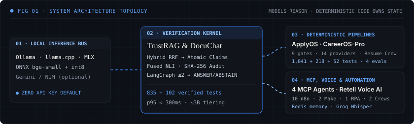
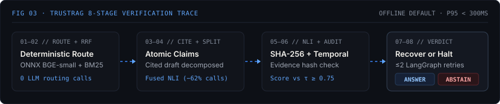

  <picture>
    <source media="(prefers-color-scheme: dark)" srcset="./assets/01-hero-monograph-dark.svg"/>
    <source media="(prefers-color-scheme: light)" srcset="./assets/01-hero-monograph-light.svg"/>
    
  </picture>

  <a href="https://maithresh.pages.dev/"><strong>maithresh.pages.dev</strong></a> ·
  <a href="https://www.linkedin.com/in/maithreshvaddi/">LinkedIn</a> ·
  <a href="mailto:maithreshvaddi16@gmail.com">maithreshvaddi16@gmail.com</a> ·
  <a href="https://leetcode.com/u/MaithreshV/">LeetCode</a> ·
  <a href="https://www.hackerrank.com/profile/maithreshvaddi16">HackerRank</a>

  <picture>
    <source media="(prefers-color-scheme: dark)" srcset="./assets/02-metrics-ledger-dark.svg"/>
    <source media="(prefers-color-scheme: light)" srcset="./assets/02-metrics-ledger-light.svg"/>
    
  </picture>

---

### Architecture & Verified Test Coverage

  <picture>
    <source media="(prefers-color-scheme: dark)" srcset="./assets/03-system-topology-dark.svg"/>
    <source media="(prefers-color-scheme: light)" srcset="./assets/03-system-topology-light.svg"/>
    
  </picture>

  <picture>
    <source media="(prefers-color-scheme: dark)" srcset="./assets/05-measured-deltas-dark.svg"/>
    <source media="(prefers-color-scheme: light)" srcset="./assets/05-measured-deltas-light.svg"/>
    
  </picture>

---

### Core AI & Agentic Systems

> I keep deterministic code in charge of routing, filtering, hashing, and state, while models handle bounded reasoning. Interactive stage simulators live at **[maithresh.pages.dev](https://maithresh.pages.dev/#workbench)**.

| System | Implementation & Guarantees | Verification & Stack |
|---|---|---|
| **[TrustRAG](https://github.com/MaithreshVaddi-27/TrustRAG)** `FLAGSHIP` | 8-stage local-first RAG workbench (`route -> retrieve -> rerank -> generate -> decompose -> verify -> audit -> recover`). Uses torch-free ONNX embeddings (`bge-small`, saving ~500-1000 MB RAM) + BM25 RRF + int8 `ms-marco` rerank, SPO atomic claim NLI (`SUPPORTED / CONTRADICTED / NEUTRAL`), SHA-256 + temporal audit, LangGraph recovery (`<=2`) or `ABSTAIN`, `q8_0` KV cache, adaptive `<=3B` prompt tiering, and a JSON-RPC 2.0 MCP server. | `86 test files (~835 cases)` across pytest, Vitest, Playwright & k6 (`p95 < 300ms` gate; measured `7,282 reqs`, `p95 9.28ms`) · `FastAPI 0.115` · `LangGraph` · `Qdrant` · `MongoDB 7` · `ONNX` · `React 18` |
| **[ApplyOS](https://github.com/MaithreshVaddi-27/ApplyOS)** | Local-first job application OS (India + global-remote) pairing Markdown workflow specs with a zero-runtime-dep Bun workspace (`applyos` CLI + read-only `applyos-tui`, 6 core packages). Runs 13 Bun portal CLIs over 14 providers in `registry.yaml`, scores with one `framework/scoring.json` table (9 gates, 4 dimensions, `not evaluated` when evidence is missing) guarded by `spec_parity.py`, and compiles LuaLaTeX CVs checked by `verify_pdf.py --check-ats`. | `96 test files (~1,041 cases)` + `4 offline eval suites` + cross-OS CI · `Bun 1.4.3` · `TypeScript` · `Python 3.10+` · `LuaLaTeX` |
| **[CareerOS-Pro](https://github.com/MaithreshVaddi-27/CareerOS-Pro)** | Self-hosted job intelligence platform pulling from 6 sources (JSearch, Adzuna, Remotive, RemoteOK, Arbeitnow + async `scrape_url()` verified on live Apple careers for 16 postings). `normalize.py` keeps unreadable fields `unknown`, `dedup.py` hashes `url_hash` + `content_hash`, hard eligibility rules run in pure Python, and a linear LangGraph state machine with a `human_review` interrupt hands approved matches to Gemini CRAFT grounding. | `17 test files (~218 functions)` + pinned Ruff rules + oxlint + Vite build · `FastAPI` · `MySQL 8` · `Qdrant` · `React 19` |
| **[Agentic DocuChat](https://github.com/MaithreshVaddi-27/MCP_Agentic_DocuChat)** | Local-first PDF companion (`v3.2.1`, Python 3.10-3.13) that pins every answer to exact **Sources** pages. Validates PDFs by `%PDF-` magic bytes, hashes file path + size + mtime + embedding model into Chroma collection names to block stale indexes, packs chunks with **TOON** (declaring `{source, page, text}` once per batch), and shares one MMR pass between the reply and Sources box (with one citation-repair pass). | `5 test files (102 unittest tests)` + DeepEval + Ruff CI · `Ollama` · `llama.cpp` · `MLX` · `Gemini` · `ChromaDB` · `SQLite` · `Composio MCP` · `Gradio` |
| **[Resume Crew](https://github.com/MaithreshVaddi-27/Resume_Crew)** | Evidence-only resume-to-JD matcher (`v1.4.0`) exporting 9 files per run (`match_report.{md,pdf,docx}`, profiles, gap analysis, tailored bullets, interview prep, `run_meta.json`). Stages report writes before publication, rejects malformed LLM scores and unauthenticated `GRADIO_SHARE=true`, exposes `--check-hardware`, and disables CrewAI telemetry for PII privacy. | `8 test files (52 pytest functions)` + coverage CI + Docker · `CrewAI 1.15.11` · `MLX-LM` · `Ollama` · `Gradio` |
| **[MCP Agents Suite](https://github.com/MaithreshVaddi-27/MCP_SkillMap_Agent)** | Four multi-turn Python CLI agents built on LangChain, LangGraph checkpointing, and Composio MCP: [SkillMap](https://github.com/MaithreshVaddi-27/MCP_SkillMap_Agent) (Tavily + RapidAPI JSearch), [SalaryInsights](https://github.com/MaithreshVaddi-27/MCP_SalaryInsights_Agent) (Firecrawl over Glassdoor, AmbitionBox, PayScale, Levels.fyi), [CourseFinder](https://github.com/MaithreshVaddi-27/MCP_CourseFinder_Agent) (Tavily + YouTube with backoff retries), and [Inbox Summarizer](https://github.com/MaithreshVaddi-27/MCP_Email_Inbox_Summarizer) (Gmail triage & drafts, never sends). | Documented retry/backoff & per-thread memory boundaries · `LangChain` · `LangGraph` · `Composio MCP` · `Gemini` |

  <picture>
    <source media="(prefers-color-scheme: dark)" srcset="./assets/04-fig01-trustrag-trace-dark.svg"/>
    <source media="(prefers-color-scheme: light)" srcset="./assets/04-fig01-trustrag-trace-light.svg"/>
    
  </picture>

---

### Voice AI, Multi-Agent Crews & Automations

- **[Home Credit LAP Voice Agent](https://github.com/MaithreshVaddi-27/home-credit-lap-voice-agent):** Bilingual (Hindi/English) Retell AI phone agent for pre-approved Loan Against Property screening up to `₹75 lakh`. Enforces a 7-item eligibility checklist with 4 hard stops (agricultural land, missing originals, cash income, tenure outside 3-15 years), negotiates the ₹75L cap, routes existing-loan holders to a specialist, and documents 7 scenario transcripts with open ASR caveats.
- **[AI Workflow Automations](https://github.com/MaithreshVaddi-27/Ai-Workflow-Automations)** (`13` workflows): 10 n8n workflows (Telegram Shopping Assistant with Groq Whisper voice + Redis per-user memory, Learning Path agent writing Google Docs + Calendar blocks, LinkedIn Job Tracker, Internship Applier, News Summarizer, Weather Daily Planner, Historical Content Publisher, [PodEase Pro](https://podease-pro.lovable.app/) live webhook to Gemini + MurfAI TTS, Learning Journey, Social Media), 2 Make.com routers (15-min social pipeline, Telegram Resume Evaluator), and 1 Automation Anywhere RPA Excel email bot.
- **[AI Game Dev Crew](https://github.com/MaithreshVaddi-27/AI-Game-Dev-Crew) & [AI Blog Writer Crew](https://github.com/MaithreshVaddi-27/Ai-Blog-Writer-Crew):** 3-agent sequential CrewAI pipelines (`Designer -> Python Dev (Serper) -> QA Reviewer` compiling browser games via `pygbag` with a `0.9.3` preloader-gate patch + `ngrok` sharing, and `Strategist -> Writer -> Editor` Markdown publishing).

Portfolio engineering, scoped team ML &amp; media builds

 

- **Portfolio Engineering:** [maithresh.sh](https://github.com/MaithreshVaddi-27/maithresh.sh) (`v2.0.0`, React 19 + Vite 8 + GSAP + Lenis + self-hosted woff2 fonts + Canvas 2D dot-matrix + axe-core `0` violations) and the live Systems Monograph at [maithresh.pages.dev](https://maithresh.pages.dev/).
- **Scoped Team ML (KMIT):** [CrimeSleuth](https://github.com/MaithreshVaddi-27/CrimeSleuth) (B.Tech II-II RTRP 2024-25: Flask REST API + MongoDB + React/Vite + ML/DL evidence analysis + Gemini case chat/reports) and [SignatureSense](https://github.com/MaithreshVaddi-27/SignatureSense) (React/Vite + Node.js/Express + MongoDB + Flask TensorFlow/Keras `model_weights33.h5` signature verification service).
- **Media & Web Foundations:** [F5-tts-podcast-generator](https://github.com/MaithreshVaddi-27/F5-tts-podcast-generator) (Kaggle T4 notebook with pinned `torch 2.4.0+cu121`, `transformers 4.44.2`, and Gradio voice cloning) and [FoodMunch](https://github.com/MaithreshVaddi-27/FoodMunch) (HTML5 + CSS3 + Bootstrap 4.5 responsive restaurant site).

---

### Engineering Stack & Build Method

| Domain | Production & Local-First Toolchain |
|---|---|
| **LLM & Agentic AI** | `LangGraph` · `LangChain` · `CrewAI` · `MCP (JSON-RPC 2.0, Composio)` · `Retell AI` · Hybrid RAG (`dense + BM25 + RRF`) · Cross-encoder rerank · NLI claim verification · `Qdrant` · `ChromaDB` · `ONNX Runtime` · `Ollama` · `llama.cpp` · `MLX` · `MLX-LM` · `Gemini` · `NVIDIA NIM` |
| **Backend & Data** | `Python` · `TypeScript` · `Java (OOP)` · `C++` · `SQL` · `FastAPI` · `Granian` · `Flask` · `httpx` · `Pydantic v2` · `SQLAlchemy 2` · `Bun` · `Node/Express` · `MySQL 8` · `MongoDB 7` · `Redis` · `SQLite` · `Pandas / NumPy` · 26+ LeetCode SQL |
| **Automations & QA** | `n8n` · `Make.com` · `Automation Anywhere` · `Docker Compose` · `pytest` · `Vitest` · `Playwright` · `k6` · `Ruff` · `oxlint` · `Bandit` · `Trivy` · `GitHub Actions` · `Cloudflare Pages` · AWS / K8s / Jenkins (labs) · `React 19` · `Gradio` |

> **Build method:** I write the architecture and line-by-line specs, use AI coding tools to speed up implementation, and own every trade-off and failure mode in review.

---

### Education & Contribution Activity

**Keshav Memorial Institute of Technology (KMIT), Hyderabad**, B.Tech CSE (2023-2027 · CGPA `7.96/10`)
Coursework: DSA · Operating Systems · DBMS · Computer Networks · Software Engineering · Cloud Computing (AWS) · Cyber Security
Applied training: NxtWave (GenAI/LLM + MCP) · StudyComrade (Data Analytics EDA) · Outskill AI Mastermind

  <picture>
    <source media="(prefers-color-scheme: dark)" srcset="https://raw.githubusercontent.com/MaithreshVaddi-27/MaithreshVaddi-27/output/pacman-contribution-graph-dark.svg"/>
    <source media="(prefers-color-scheme: light)" srcset="https://raw.githubusercontent.com/MaithreshVaddi-27/MaithreshVaddi-27/output/pacman-contribution-graph.svg"/>
    
  </picture>

  Open to AI/ML, GenAI &amp; Backend Engineering internships · Hyderabad, India / Remote · <a href="https://maithresh.pages.dev/"><strong>maithresh.pages.dev</strong></a> · <a href="mailto:maithreshvaddi16@gmail.com">maithreshvaddi16@gmail.com</a>

