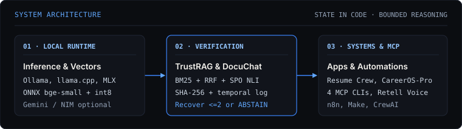

  <picture>
    <source media="(prefers-color-scheme: dark)" srcset="./assets/01-hero-monograph-dark.svg"/>
    <source media="(prefers-color-scheme: light)" srcset="./assets/01-hero-monograph-light.svg"/>
    
  </picture>

  <a href="https://maithresh.pages.dev/"><strong>maithresh.pages.dev</strong></a> ·
  <a href="https://www.linkedin.com/in/maithreshvaddi/">LinkedIn</a> ·
  <a href="mailto:maithreshvaddi16@gmail.com">maithreshvaddi16@gmail.com</a> ·
  <a href="https://leetcode.com/u/MaithreshV/">LeetCode</a> ·
  <a href="https://www.hackerrank.com/profile/maithreshvaddi16">HackerRank</a>

I build local-first AI systems and backend tools in Python and TypeScript. Deterministic code manages routing, filtering, hashing, and state. Language models handle bounded reasoning where claims can be verified or rejected.

  <picture>
    <source media="(prefers-color-scheme: dark)" srcset="./assets/02-system-topology-dark.svg"/>
    <source media="(prefers-color-scheme: light)" srcset="./assets/02-system-topology-light.svg"/>
    
  </picture>

---

## Selected systems

Interactive stage simulators and architecture notes live at [maithresh.pages.dev/#workbench](https://maithresh.pages.dev/#workbench).

- **[TrustRAG](https://github.com/MaithreshVaddi-27/TrustRAG)** (FastAPI, LangGraph, Qdrant, MongoDB 7, ONNX Runtime)

  An 8-stage local RAG workbench that pairs torch-free ONNX (`bge-small`) embeddings with BM25 reciprocal rank fusion and `int8` reranking. Draft claims are split into SPO triples for NLI checks (`SUPPORTED`, `CONTRADICTED`, `NEUTRAL`), recorded with SHA-256 and temporal audits, and routed through at most two LangGraph recovery passes before returning an answer or `ABSTAIN`. Tested across 86 files (~835 cases), an MCP server interface, prompt tiering for `<=3B` local models, and a k6 load run (`7,282` requests, `p95 9.28ms` under a `300ms` target).

- **[Agentic DocuChat](https://github.com/MaithreshVaddi-27/MCP_Agentic_DocuChat)** (Ollama, llama.cpp, MLX, ChromaDB, Composio MCP)

  Offline PDF Q&A (`v3.2.1`) designed so replies stay anchored to exact source pages. Validates `%PDF-` magic bytes, fingerprints Chroma collections to reject stale indexes, packs chunks with TOON, shares a single MMR pass between generation and citations, and runs 5 unittest suites (102 cases) with DeepEval checks.

- **[ApplyOS](https://github.com/MaithreshVaddi-27/ApplyOS)** (Bun 1.4.3, TypeScript, Python 3.10+, LuaLaTeX)

  A local-first job application workspace (`applyos` CLI and read-only TUI across 6 packages) built with zero runtime npm dependencies and 13 portal CLIs spanning 14 providers. Scoring stays deterministic through `framework/scoring.json` (9 gates across 4 dimensions) guarded by `spec_parity.py`, alongside ATS-checked LuaLaTeX resume builds, 96 test files (~1,041 cases), and 4 offline evaluation suites.

- **[Resume Crew](https://github.com/MaithreshVaddi-27/Resume_Crew)** (CrewAI 1.15.11, MLX-LM, Ollama, Gradio, Docker)

  Evidence-only resume-to-JD matcher (`v1.4.0`) that refuses ungrounded edits and writes 9 artifacts per run (`PDF`, `DOCX`, `MD`, gap report, `run_meta.json`). Ships with staged file writes, auth-gated `GRADIO_SHARE`, `--check-hardware` checks, telemetry disabled, and 8 pytest files (52 cases).

- **[CareerOS-Pro](https://github.com/MaithreshVaddi-27/CareerOS-Pro)** (FastAPI, MySQL 8, Qdrant, React 19)

  Self-hosted job tracker pulling from 6 sources plus async `scrape_url()` ingestion (tested on Apple Careers across 16 listings). Uses pure-Python `normalize.py` rules where missing fields stay `unknown`, `url_hash` and `content_hash` deduplication, a LangGraph `human_review` gate, and Gemini CRAFT explanations, checked by 17 test files (~218 functions) and pinned Ruff and `oxlint` rules.

- **[MCP Agents Suite](https://github.com/MaithreshVaddi-27/MCP_SkillMap_Agent)** (LangChain, LangGraph, Composio MCP, Gemini)

  Four multi-turn CLI agents built with retry/backoff and thread memory: [SkillMap](https://github.com/MaithreshVaddi-27/MCP_SkillMap_Agent) (Tavily + JSearch), [SalaryInsights](https://github.com/MaithreshVaddi-27/MCP_SalaryInsights_Agent) (Firecrawl), [CourseFinder](https://github.com/MaithreshVaddi-27/MCP_CourseFinder_Agent) (Tavily + YouTube), and [Inbox Summarizer](https://github.com/MaithreshVaddi-27/MCP_Email_Inbox_Summarizer) (restricted to Gmail drafts).

---

## Voice, automations and multi-agent pipelines

- **[Home Credit LAP Voice Agent](https://github.com/MaithreshVaddi-27/home-credit-lap-voice-agent)** on Retell AI conducts bilingual Hindi and English Loan Against Property pre-screening up to `₹75 lakh`. Enforces a 7-rule checklist with 4 hard stops (agricultural land, missing originals, cash income, tenure outside 3-15 years), handles ₹75L cap negotiation, routes existing-loan callers to a specialist, and documents 7 test transcripts along with known ASR caveats.

- **[AI Workflow Automations](https://github.com/MaithreshVaddi-27/Ai-Workflow-Automations)** organizes 13 working automations: 10 n8n flows (including a Telegram shopping assistant using Groq Whisper voice transcription and Redis per-user memory, plus the [PodEase Pro](https://podease-pro.lovable.app/) live webhook wired to Gemini and MurfAI TTS), 2 Make.com routers (a 15-minute social pipeline and a Telegram resume evaluator), and 1 Automation Anywhere RPA Excel email workflow.

- **[AI Game Dev Crew](https://github.com/MaithreshVaddi-27/AI-Game-Dev-Crew)** and **[AI Blog Writer Crew](https://github.com/MaithreshVaddi-27/Ai-Blog-Writer-Crew)** run 3-agent sequential CrewAI pipelines (`Designer -> Python Dev -> QA Reviewer` compiling browser games with `pygbag`, patched for the `0.9.3` preloader gate and exposed via `ngrok`; `Strategist -> Writer -> Editor` outputting Markdown drafts).

Portfolio engineering, university team ML and audio tools

 

- **[maithresh.sh](https://github.com/MaithreshVaddi-27/maithresh.sh)** (`v2.0.0`, React 19, Vite 8, GSAP, Lenis, self-hosted `woff2` typography, Canvas 2D dot-matrix, zero `axe-core` accessibility violations) alongside the live portfolio at [maithresh.pages.dev](https://maithresh.pages.dev/).
- **[CrimeSleuth](https://github.com/MaithreshVaddi-27/CrimeSleuth)** and **[SignatureSense](https://github.com/MaithreshVaddi-27/SignatureSense)** are B.Tech team ML builds at KMIT pairing React/Vite interfaces and MongoDB with Flask APIs, Gemini evidence summaries (`CrimeSleuth`), and TensorFlow/Keras signature classification (`SignatureSense`, `model_weights33.h5`).
- **[F5-tts-podcast-generator](https://github.com/MaithreshVaddi-27/F5-tts-podcast-generator)** runs F5-TTS voice cloning in a Kaggle T4 notebook (`torch 2.4.0+cu121`, `transformers 4.44.2`, Gradio).

---

## Toolchain

| Area | Primary tools |
|---|---|
| Retrieval & Agents | LangGraph, LangChain, CrewAI, Composio MCP, Retell AI, Qdrant, ChromaDB, ONNX Runtime, Ollama, llama.cpp, MLX, Gemini |
| Backend & Data | Python, TypeScript, SQL, Java, C++, FastAPI, Granian, Flask, Bun, Node.js, MySQL 8, MongoDB 7, Redis, SQLite |
| Automation & Testing | n8n, Make.com, Docker Compose, pytest, Vitest, Playwright, k6, Ruff, oxlint, Bandit, Trivy, GitHub Actions, React 19, Gradio |

---

## Background & activity

Final-year B.Tech CSE student at Keshav Memorial Institute of Technology (KMIT), Hyderabad (2023-2027, CGPA 7.96/10), with applied training in GenAI/LLM, MCP tooling, and exploratory data analysis through NxtWave, StudyComrade, and Outskill.

  <picture>
    <source media="(prefers-color-scheme: dark)" srcset="https://raw.githubusercontent.com/MaithreshVaddi-27/MaithreshVaddi-27/output/pacman-contribution-graph-dark.svg?palette=cobalt"/>
    <source media="(prefers-color-scheme: light)" srcset="https://raw.githubusercontent.com/MaithreshVaddi-27/MaithreshVaddi-27/output/pacman-contribution-graph.svg?palette=cobalt"/>
    
  </picture>

  Open to AI/ML and Backend Engineering internships · Hyderabad, India / Remote · <a href="https://maithresh.pages.dev/"><strong>maithresh.pages.dev</strong></a> · <a href="mailto:maithreshvaddi16@gmail.com">maithreshvaddi16@gmail.com</a>

