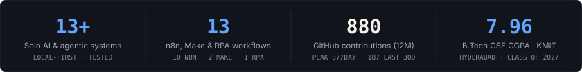
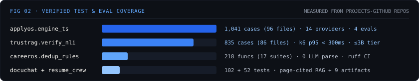

  <picture>
    <source media="(prefers-color-scheme: dark)" srcset="./assets/01-hero-monograph-dark.svg"/>
    <source media="(prefers-color-scheme: light)" srcset="./assets/01-hero-monograph-light.svg"/>
    
  </picture>

  <a href="https://maithresh.pages.dev/"><strong>Portfolio · maithresh.pages.dev</strong></a> ·
  <a href="https://www.linkedin.com/in/maithreshvaddi/">LinkedIn</a> ·
  <a href="mailto:maithreshvaddi16@gmail.com">maithreshvaddi16@gmail.com</a> ·
  <a href="https://leetcode.com/u/MaithreshV/">LeetCode</a> ·
  <a href="https://www.hackerrank.com/profile/maithreshvaddi16">HackerRank</a>

  <picture>
    <source media="(prefers-color-scheme: dark)" srcset="./assets/02-metrics-ledger-dark.svg"/>
    <source media="(prefers-color-scheme: light)" srcset="./assets/02-metrics-ledger-light.svg"/>
    
  </picture>

---

### `FIG 01–02` · System Architecture & Verified Coverage

  <picture>
    <source media="(prefers-color-scheme: dark)" srcset="./assets/03-system-topology-dark.svg"/>
    <source media="(prefers-color-scheme: light)" srcset="./assets/03-system-topology-light.svg"/>
    
  </picture>

  <picture>
    <source media="(prefers-color-scheme: dark)" srcset="./assets/05-measured-deltas-dark.svg"/>
    <source media="(prefers-color-scheme: light)" srcset="./assets/05-measured-deltas-light.svg"/>
    
  </picture>

---

### `SYS 01–06` · Featured AI & Agentic Systems

> Every metric below maps directly to repository code, test suites, and documented caveats — interactive stage simulators and trade-offs live at **[maithresh.pages.dev](https://maithresh.pages.dev/#workbench)**.

| System | Architecture & Hard Guarantee | Verification & Stack |
|---|---|---|
| **[TrustRAG](https://github.com/MaithreshVaddi-27/TrustRAG)** `FLAGSHIP` | 8-stage local-first RAG reliability workbench: deterministic route (`0` LLM), hybrid `bge-small` (ONNX) + BM25 RRF + int8 `ms-marco` rerank, SPO atomic claim NLI (`SUPPORTED / CONTRADICTED / NEUTRAL`), SHA-256 + temporal audit, LangGraph recovery `≤2` or `ABSTAIN`. Adaptive `≤3B` vs larger-model prompt tiering + `q8_0` KV cache. | `86 test files (~835 cases)` across pytest, Vitest, Playwright & k6 (`p95 < 300ms`) · `FastAPI 0.115` · `LangGraph` · `Qdrant` · `MongoDB 7` · `ONNX` · `MCP JSON-RPC 2.0` · `React 18` |
| **[ApplyOS](https://github.com/MaithreshVaddi-27/ApplyOS)** | Runtime-agnostic job application OS (India + global-remote): zero-runtime-dep Bun workspace (`applyos` CLI + read-only `applyos-tui`, 6 core packages), 13 Bun portal CLIs, 14 providers in `registry.yaml` (6 aggregators + 8 ATS adapters), 9-gate / 4-dim ranker (`not evaluated` over guessing), ATS-checked LuaLaTeX CVs (`verify_pdf.py --check-ats`). | `96 test files (~1,041 cases)` + `4 offline eval suites` + cross-OS CI · `Bun 1.4.3` · `TypeScript` · `Python 3.10+` · `LuaLaTeX` |
| **[CareerOS-Pro](https://github.com/MaithreshVaddi-27/CareerOS-Pro)** | Self-hosted job intelligence across 6 sources (JSearch, Adzuna, Remotive, RemoteOK, Arbeitnow + async URL company scraper). Pure-Python `normalize.py` (`unknown` stays `unknown`), `url_hash` + `content_hash` dedup, hard eligibility gates, linear LangGraph `human_review` interrupt, CRAFT-grounded Gemini match explanations. | `17 test files (~218 functions)` + pinned Ruff CI + oxlint + live scraper verification · `FastAPI` · `MySQL 8` · `Qdrant` · `React 19` |
| **[Agentic DocuChat](https://github.com/MaithreshVaddi-27/MCP_Agentic_DocuChat)** | Offline-first PDF reading companion (`Python 3.10–3.13`) pinned to exact **Sources** pages (rewrites draft once if citations missing). Runs on Ollama, llama.cpp, or MLX with optional Gemini; content-hash vector caching, durable local memory, and prompt-injection resistant evidence isolation. | `5 test files (102 unittest tests)` · `Ollama` · `llama.cpp` · `MLX` · `Gemini` · `ChromaDB` · `SQLite` · `Composio MCP` · `Gradio` |
| **[Resume Crew](https://github.com/MaithreshVaddi-27/Resume_Crew)** | Evidence-only resume↔JD matcher (`v1.4.0`) exporting 9 artifacts per run (`match_report.{md,pdf,docx}`, profiles, skills gap, tailored bullets, interview prep, `run_meta.json`). Zero invented skills, `--check-hardware` diagnostics, and CrewAI telemetry disabled by default. | `8 test files (52 pytest functions)` + coverage CI + Docker · `CrewAI 1.15.11` · `MLX-LM` · `Ollama` · `Gradio` |
| **[MCP Agents Suite](https://github.com/MaithreshVaddi-27/MCP_SkillMap_Agent)** | Four multi-turn Python CLI agents built on LangChain, LangGraph in-memory checkpointing, and Composio MCP: [SkillMap](https://github.com/MaithreshVaddi-27/MCP_SkillMap_Agent) (Tavily + JSearch), [SalaryInsights](https://github.com/MaithreshVaddi-27/MCP_SalaryInsights_Agent) (Firecrawl: Glassdoor/AmbitionBox/PayScale/Levels.fyi), [CourseFinder](https://github.com/MaithreshVaddi-27/MCP_CourseFinder_Agent) (Tavily + YouTube), and [Inbox Summarizer](https://github.com/MaithreshVaddi-27/MCP_Email_Inbox_Summarizer) (Gmail triage & drafts). | Explicit retry/backoff & per-thread memory boundaries · `LangChain` · `LangGraph` · `Composio MCP` · `Gemini` |

  <picture>
    <source media="(prefers-color-scheme: dark)" srcset="./assets/04-fig01-trustrag-trace-dark.svg"/>
    <source media="(prefers-color-scheme: light)" srcset="./assets/04-fig01-trustrag-trace-light.svg"/>
    
  </picture>

---

### `VOICE · CREWS · AUTO` · Voice AI, Multi-Agent Crews & Workflow Automations

- **[Home Credit LAP Voice Agent](https://github.com/MaithreshVaddi-27/home-credit-lap-voice-agent)** — Bilingual (Hindi/English) **Retell AI** pre-screening voice agent for Loan Against Property offers up to `₹75 lakh`: 7-item eligibility rules with 4 hard stops (agricultural land, missing originals, cash income, tenure outside 3–15 yrs), ₹75L cap negotiation, loan-transfer specialist routing, and `7` scenario transcripts with documented ASR caveats.
- **[AI Workflow Automations](https://github.com/MaithreshVaddi-27/Ai-Workflow-Automations)** (`13` workflows) — **10 n8n** (Telegram Shopping Assistant w/ Groq Whisper voice + Redis per-user memory, Learning Path → Google Doc + Calendar, LinkedIn Job Tracker, Internship Applier, News Summarizer, Weather Daily Planner, Historical Content Publisher, [PodEase Pro](https://podease-pro.lovable.app/) `LIVE` webhook → Gemini → MurfAI TTS, Learning Journey, Social Media) · **2 Make.com** (15-min multi-platform router, Telegram Resume Evaluator) · **1 Automation Anywhere RPA** (Excel loop email reminder bot).
- **[AI Game Dev Crew](https://github.com/MaithreshVaddi-27/AI-Game-Dev-Crew) & [AI Blog Writer Crew](https://github.com/MaithreshVaddi-27/Ai-Blog-Writer-Crew)** — 3-agent sequential CrewAI pipelines: `Designer → Python Dev (Serper) → QA Reviewer` compiling browser games via `pygbag` (with `0.9.3` preloader-gate patch) + `ngrok`, and `Strategist → Writer → Editor` timestamped Markdown publishing.

<code>ARCHIVE</code> · Portfolio engineering, scoped team ML &amp; media/web builds

 

- **Portfolio & Engineering Surface:** **[maithresh.sh](https://github.com/MaithreshVaddi-27/maithresh.sh)** (`v2.0.0`, React 19 + Vite 8 + GSAP + Lenis + self-hosted fonts + Canvas 2D dot-matrix + axe-core 0 violations) and the live Systems Monograph at **[maithresh.pages.dev](https://maithresh.pages.dev/)**.
- **Scoped Team ML (KMIT / full-stack):** **[CrimeSleuth](https://github.com/MaithreshVaddi-27/CrimeSleuth)** (KMIT B.Tech II-II RTRP 2024–25: Flask REST API + MongoDB + React/Vite + ML/DL evidence analysis + Gemini case chat/reports) · **[SignatureSense](https://github.com/MaithreshVaddi-27/SignatureSense)** (React/Vite + Node.js/Express + MongoDB + Flask TensorFlow/Keras `model_weights33.h5` signature verification service).
- **Media & Web Foundations:** **[F5-tts-podcast-generator](https://github.com/MaithreshVaddi-27/F5-tts-podcast-generator)** (reproducible Kaggle T4 notebook with pinned `torch 2.4.0+cu121`, `transformers 4.44.2`, Gradio voice cloning) · **[FoodMunch](https://github.com/MaithreshVaddi-27/FoodMunch)** (HTML5 + CSS3 + Bootstrap 4.5 responsive restaurant site).

---

### `STACK // METHOD` · Engineering Stack & Build Discipline

| Domain | Production & Local-First Toolchain |
|---|---|
| **LLM & Agentic AI** | `LangGraph` · `LangChain` · `CrewAI` · `MCP (JSON-RPC 2.0, Composio)` · `Retell AI` · Hybrid RAG (`dense + BM25 + RRF`) · Cross-encoder rerank · NLI claim verification · `Qdrant` · `ChromaDB` · `ONNX Runtime` · `Ollama` · `llama.cpp` · `MLX` · `MLX-LM` · `Gemini` · `NVIDIA NIM` |
| **Backend & Data** | `Python` · `TypeScript` · `Java (OOP)` · `C++` · `SQL` · `FastAPI` · `Granian` · `Flask` · `httpx` · `Pydantic v2` · `SQLAlchemy 2` · `Bun` · `Node/Express` · `MySQL 8` · `MongoDB 7` · `Redis` · `SQLite` · `Pandas / NumPy` · 26+ LeetCode SQL |
| **Automations & QA** | `n8n` · `Make.com` · `Automation Anywhere` · `Docker Compose` · `pytest` · `Vitest` · `Playwright` · `k6` · `Ruff` · `oxlint` · `Bandit` · `Trivy` · `GitHub Actions` · `Cloudflare Pages` · AWS / K8s / Jenkins (labs) · `React 19` · `Gradio` |

> **Build method:** Spec-first, AI-assisted — I write the architecture and line-by-line specifications, direct implementation via agentic coding tools, and retain ownership of every design decision and documented failure mode.

---

### `KMIT // CADENCE` · Education & Contribution Activity

**Keshav Memorial Institute of Technology (KMIT), Hyderabad** — B.Tech CSE (2023–2027 · CGPA `7.96/10`)
Coursework: DSA · Operating Systems · DBMS · Computer Networks · Software Engineering · Cloud Computing (AWS) · Cyber Security
Applied training: NxtWave (GenAI/LLM + MCP) · StudyComrade (Data Analytics EDA) · Outskill AI Mastermind

  <picture>
    <source media="(prefers-color-scheme: dark)" srcset="https://raw.githubusercontent.com/MaithreshVaddi-27/MaithreshVaddi-27/output/pacman-contribution-graph-dark.svg"/>
    <source media="(prefers-color-scheme: light)" srcset="https://raw.githubusercontent.com/MaithreshVaddi-27/MaithreshVaddi-27/output/pacman-contribution-graph.svg"/>
    
  </picture>

  Open to AI/ML, GenAI &amp; Backend Engineering internships · Hyderabad, India / Remote · <a href="https://maithresh.pages.dev/"><strong>maithresh.pages.dev</strong></a> · <a href="mailto:maithreshvaddi16@gmail.com">maithreshvaddi16@gmail.com</a>

